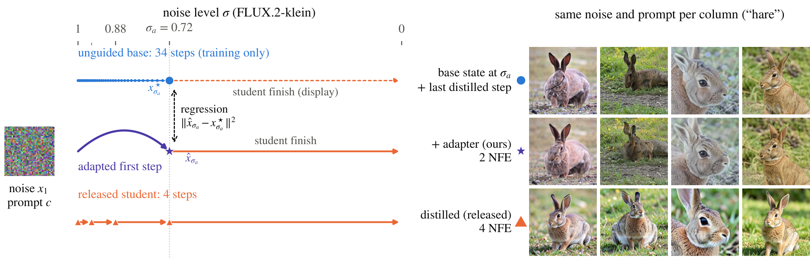

# Fast and Useful: train the first-step adapter

Train the adapter from **Fast and Useful: Adapting Distilled Generators for Visual Learning** and generate training
data with it.

[Paper](https://arxiv.org/abs/2610.32512) | [Project page](https://fast-and-useful.github.io)

Distilled text-to-image models generate images in a few steps, but classifiers trained on their images perform worse
than classifiers trained on images from the slower base models they were distilled from. The adapter is a low-rank
update to the distilled student's first prediction, trained so that the student's first step jumps from pure noise to
the latent its unguided base reaches from the same noise after many fine steps. At generation the update runs for that
one prediction; the released student then finishes the image unchanged, and the base model is not loaded.

<p align="center"></p>

*Left: FLUX.2-klein's released four-step student (orange), its unguided base on a fine grid (blue) and the adapted
sampler (violet). The first prediction is trained to reach the base's latent at σ<sub>a</sub>; the unchanged student
then finishes in one step: two denoiser evaluations, and no base model at generation. Right: matching noise and hare
prompts, completed from the teacher's target, by the adapter, or by the released student.*

In the paper, with class-name prompts at full ImageNet-1k scale (1,281 images per class), a ResNet-50 trained only on
generated images reaches 34.2% top-1 on the real validation images with FLUX.2-klein's adapter (8.4% with the released
student) at two denoiser evaluations per image, and 32.1% with SD-Turbo's (12.7%) at three. Those adapters were fitted
on ImageNet-100 class names and used unchanged on the other 900 classes, and on Food-101, Stanford Cars and
Oxford-IIIT Pets.

## Supported models

| `--model` | Released student (generation) | Base model (targets only) | Jump endpoint | Denoiser evaluations per image |
|---|---|---|---|---|
| `flux2-klein` | [FLUX.2-klein 4B](https://huggingface.co/black-forest-labs/FLUX.2-klein-4B) | [FLUX.2-klein base 4B](https://huggingface.co/black-forest-labs/FLUX.2-klein-base-4B) | σ = 0.7175, level 3 of 4 | 2 (released student: 4) |
| `sd-turbo` | [SD-Turbo](https://huggingface.co/stabilityai/sd-turbo) | [SD 2.1](https://huggingface.co/sd2-community/stable-diffusion-2-1-base) (its UNet) | t = 499, level 2 of 4 | 3 (released student: 4) |
| `z-image-turbo` | [Z-Image-Turbo](https://huggingface.co/Tongyi-MAI/Z-Image-Turbo) | [Z-Image](https://huggingface.co/Tongyi-MAI/Z-Image) | σ = 0.8571, level 3 of 9 | 7 (released student: 9) |

The jump endpoint is one of the student's own noise levels, so the unchanged student continues on its own schedule.
Images are 512 x 512 px, as in the paper.

## Install

Python 3.10 or newer (tested with 3.12) and a CUDA GPU.

```bash
git clone https://github.com/fast-and-useful/adapter
cd adapter
python -m venv .venv && source .venv/bin/activate
pip install torch --index-url https://download.pytorch.org/whl/cu128   # or the build for your CUDA, see pytorch.org
pip install -e .
```

The models download from the Hugging Face Hub on first use (set `HF_HOME` to choose where).

## Quick start: the paper's FLUX.2-klein adapter

```bash
# 1. Training pairs: the unguided base from 16,000 noises (160 per ImageNet-100 class, eight prompt templates)
fau-adapter targets --model flux2-klein --classes imagenet100 --per-class 160 --out runs/flux2-klein/targets

# 2. The adapter: rank-32 updates, 3,000 steps of 8 pairs
fau-adapter train --targets runs/flux2-klein/targets --out runs/flux2-klein/adapter

# 3. Images: the adapter for the first prediction, then the released student
fau-adapter generate --adapter runs/flux2-klein/adapter --prompt "a photo of a red panda." --per-prompt 4 --out samples
```

The defaults of `targets` and `train` are the paper's settings; replace `flux2-klein` with `sd-turbo` or
`z-image-turbo` for the other models.
`fau-adapter <command> --help` lists all options. The paper's runs of the first two commands took 4.6 and 1.1 hours
on one H100 ([Cost](#cost)).

## Generate a dataset

With `--classes`, `generate` writes one folder per class, ready for `torchvision.datasets.ImageFolder`. ImageNet-100
as in the paper, 500 images per class stored at 256 px:

```bash
fau-adapter generate --adapter runs/flux2-klein/adapter --classes imagenet100 --per-class 500 --resize 256 \
    --out data/imagenet100-klein
```

The folders are named by WordNet id (`data/imagenet100-klein/n02869837/00000.jpg`, ...), so the classes line up with
ImageNet's own folders. `imagenet1k` gives all 1,000 classes. Image j of class k uses prompt template j mod 8
("a photo of a {}.", "a close-up photo of a {}.", ...) and the seed 1,000,003 k + j, as the paper's datasets did; with
fixed seeds, rerunning an interrupted command finishes it. With `--model flux2-klein` instead of `--adapter`, the
released student makes the same dataset for comparison.

## Your own classes or prompts

- **Class names:** `--classes my-classes.txt`, one class per line, either `<id><TAB><name>` (the id names the
  image folder) or `<name>`. Each class is prompted through the eight photo templates.
- **Prompts:** `--prompts captions.txt`, one prompt per line, used as written; or `--prompt "..."` for one prompt.
  `--per-prompt N` sets the images (for `generate`) or noises (for `targets`) per prompt.

An adapter does not need to be fitted on the classes it generates: the paper's ImageNet-100 adapters served the other
900 ImageNet classes and three fine-grained datasets unchanged, and adapters fitted on 16,000 COCO captions instead of
class names can replace them. To fit on captions:

```bash
fau-adapter targets --model sd-turbo --prompts captions.txt --per-prompt 1 --out runs/sd-turbo-captions/targets
```

## Several GPUs

`targets` and `generate` split their work: start one process per GPU with the same arguments plus
`--worker i --num-workers n`. Both skip finished work, so rerunning an interrupted command resumes it. `train` uses one
GPU.

```bash
for i in 0 1 2 3; do
  CUDA_VISIBLE_DEVICES=$i fau-adapter targets --model flux2-klein --classes imagenet100 --per-class 160 \
      --out runs/flux2-klein/targets --worker $i --num-workers 4 &
done; wait
```

## Cost

| `--model` | Downloads | Targets, 16,000 pairs | Fit, 3,000 steps | Disk for the targets |
|---|---|---|---|---|
| `flux2-klein` | 30 GB | 4.6 H100-hours | 1.1 H100-hours | 8.4 GB |
| `sd-turbo` | 4 GB | 0.7 | 0.2 | 1.0 GB |
| `z-image-turbo` | 51 GB | about 5 | 1.6 | 8.4 GB |

The hours are the paper's preparation runs on one H100. Their teacher also ran past the jump endpoint to record states
for the ablations, so the targets take less with this code. `train` keeps every pair in CPU memory (the disk figure)
plus, for FLUX.2-klein, 6 GB of prompt embeddings. Z-Image-Turbo's fit peaked at 27 GB of GPU memory; with less,
`--grad-accum 2` (or 4) splits each batch into passes with the same result. Generation on one H100 took 0.10 s per
image with FLUX.2-klein's adapter (batches of 8) and 0.026 s with SD-Turbo's (batches of 32).

## Python

```python
from fau_adapter import AdaptedGenerator

generator = AdaptedGenerator("runs/flux2-klein/adapter")   # or AdaptedGenerator(model="flux2-klein"): the released student
images = generator(["a photo of a red panda.", "a photo of a hare."], seeds=[0, 1])   # PIL images
images[0].save("red-panda.jpg")
```

## How it works

**Targets.** For every prompt c and starting noise x<sub>1</sub>, the unguided base (guidance weight 1) runs its own
sampler on a fine grid (its native 50-step levels with the student's levels put in) down to the jump endpoint
σ<sub>a</sub> and gives the target x*<sub>σa</sub>(x<sub>1</sub>, c). Noise seeds of the pairs are 1,000,003 k + 600,000
+ j, so they never coincide with a generated dataset's.

**Fit.** The released weights stay frozen; every linear layer of the student's transformer blocks (for SD-Turbo, of
its UNet's attention blocks) gets an update ΔW = BA of rank 32, with B zero at the start so training starts from the
released model. The first prediction is one Euler step from pure noise straight to σ<sub>a</sub>:

L(ΔW) = E<sub>x<sub>1</sub>, c</sub> ‖ x<sub>1</sub> + (σ<sub>a</sub> − 1) v<sub>θ+ΔW</sub>(x<sub>1</sub>, 1, c) − x*<sub>σa</sub>(x<sub>1</sub>, c) ‖²

(SD-Turbo: the same Euler step in its scheduler's noise scale, from 14.6 at timestep 999 to 1.61 at 499). AdamW at
1e-4 with 100 warmup steps and cosine decay, 3,000 steps of 8 pairs (16 for SD-Turbo); the update is computed in
float32. A fixed 5% of the pairs is held out: `train` reports the error of the first prediction relative to how far the
noise is from the target (relative error), and to how far an empty image's latent is (content error, comparable across
models); 1 is no better than the released step. The last line reports it with the update folded into the weights in the
generation precision, as `generate` runs it.

**Generation.** The update is folded into the weights for the first prediction, which jumps from pure noise to
σ<sub>a</sub>; then it is switched off and the released student takes its own remaining steps. The paper's images were
generated the same way.

## Options worth knowing

- `targets --target-level L` moves the jump endpoint to another of the student's levels (FLUX.2-klein: 2 or 3;
  SD-Turbo and Z-Image-Turbo: 1 to 3). The defaults are the
  paper's choices, selected by the accuracy of classifiers trained on the generated images and tested on real
  validation images; the fit's error does not choose it. Shorter jumps gave lower accuracy in the paper's ablations.
- `targets --teacher-guidance W` sets the base's classifier-free guidance weight. The default, 1, is unguided; guided
  targets gave lower accuracy in the paper's ablations.
- `train --rank`, `--steps`, `--lr`, `--batch-size`, `--seed` change the fit; in the paper's ablation, ranks 8 and 128
  moved accuracy by less than one point.
- `generate --seed-offset N` draws another dataset with the same prompts.
- `--student PATH`, `--teacher PATH` load a local copy or a mirror of a model.

## Files

- `targets` writes `config.json` (model, endpoint, prompt source, counts), `prompts.json`, and parts
  `part-00000.safetensors`, ... with the noises, targets and prompt ids.
- `train` writes `adapter.safetensors` and `training.json` (the configuration and the held-out errors). The adapter's
  tensors are `<denoiser>.<layer>.lora_A.weight` (rank x in) and `<denoiser>.<layer>.lora_B.weight` (out x rank) in
  float32, ΔW = BA with scale 1; the file's metadata holds the model, the endpoint and the training configuration.
- `generate` writes the images and `generation.json` with its settings; with prompts, also `prompts.txt` and images
  named `<prompt number>_<index>.jpg`.

## Add another generator

A generator pair is a subclass of `Model` in [fau_adapter/models.py](fau_adapter/models.py): the student's own
levels, the teacher's fine grid that passes through them, loading both pipelines, the starting noise, the teacher's
target, prompt embeddings, the first prediction in the student's coordinates, and generation. The three existing
classes are templates; register a new one in `MODELS`.

## Check your setup

```bash
pip install -e ".[test]" && pytest tests        # CPU only
scripts/smoke_test.sh sd-turbo                  # every command at toy size on one GPU (downloads the models)
```

## Citation

```bibtex
@misc{bartkowiak2026fastusefuladaptingdistilled,
      title={Fast and Useful: Adapting Distilled Generators for Visual Learning},
      author={Patryk Bartkowiak and Dominik Michels and Sören Pirk and Wojciech Pałubicki},
      year={2026},
      eprint={2610.32512},
      archivePrefix={arXiv},
      primaryClass={cs.CV},
      url={https://arxiv.org/abs/2610.32512},
}
```

## License

The code is under the [MIT License](LICENSE). The method figure is from the paper and is under
[CC BY 4.0](https://creativecommons.org/licenses/by/4.0/), like the paper. The generators are not part of this
repository: each downloads from the Hugging Face Hub under its own license, so check its model card before use.
